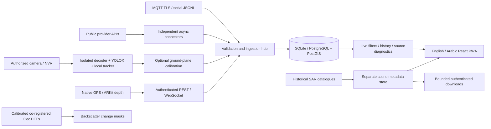

# Architecture and measurement contracts

## Storage and contracts

`sources` stores registration, explicit availability, authentication state, coverage statement, last success, latest known acquisition, latency, update interval, rate-limit deadline, errors and data quality. A successful empty request is `empty`, not a failed source or proof that the area is empty. Unconfigured sources are never marked connected.

`observations` stores immutable UUID events, a content-based deduplication key, source ID/type, class, source-local track ID, optional geographic coordinates / altitude / speed / heading / confidence / location uncertainty, acquisition timestamp, receipt timestamp, measurement basis, a database raw-data reference, original provider fields and interpretation details. Full duplicate payloads collapse atomically. Identical track IDs from different sources never fuse. Tokens/password fields are redacted before storage.

`scenes` stores historical catalogue products, footprint geometry, acquisition time, product metadata and asset URLs separately from object observations. ASF and CDSE may describe the same acquisition; source-specific records stay separate and the UI counts **records**, not unique satellite passes.

`cameras` stores operator acknowledgement time, a **server environment-variable name**, camera position/direction/FOV when known, and calibration. Stream credentials and URLs do not travel to the frontend. `downloads` records durable jobs, status, bytes and blockers. Interrupted jobs are marked interrupted on startup and can be explicitly resubmitted; partial transfer resume is not implemented.

SQLite uses WAL, foreign keys and Python 3.12 non-legacy transaction control so a rejected batch rolls back despite deduplication savepoints. PostgreSQL migrations install PostGIS, a generated WGS84 geography point and a GiST index. Queries use `ST_DWithin` to narrow PostgreSQL candidates, then the same exact ellipsoidal distance validation as SQLite. Migrations upgrade/downgrade on SQLite and PostgreSQL were exercised.

## Units, geometry and clocks

* WGS84: latitude/longitude in degrees. Coordinates must be valid and supplied together, or both null.
* Distance: **horizontal geodesic ground distance** in metres, computed using `pyproj.Geod(ellps="WGS84")`; not aircraft slant range. Bearing is initial geodesic azimuth clockwise from north; coincident-point bearing is null.
* Altitude: metres; provider-specific datum is preserved in details. ADS-B barometric altitude is not assumed to be terrain-relative or equivalent to geometric altitude.
* Speed: m/s, displayed as km/h. ADS-B / AIS knots multiply by 0.514444; ADS-B feet multiply by 0.3048. Road-segment speed never becomes an individual vehicle's measurement.
* All stored acquisition / receipt times use UTC. Time filters require timezones. Acquisition timestamps beyond a 120-second clock tolerance are rejected. Old data remains historical; client and backend both exclude old reports from live views.
* ADS-B `now` is milliseconds since the Unix epoch, with `seen_pos` subtracted for acquisition age. Raw fields remain available. Missing position timestamps cause the record to be skipped rather than timestamped as fresh.
* TomTom Flow does **not** supply a measurement timestamp in its normal response: `observed_at` and `freshness_seconds` remain **null**. Receipt time is distinct; the Traffic page can show a recently retrieved report without implying its measurement is current.
* AISstream metadata supplies a receiver timestamp, not a full vessel-generated UTC date. This distinction is retained in details. Invalid position (91°/181°), course (360°) and unavailable speed (102.3 knots) codes do not turn into measurements.
* Camera timestamps refer to frame decode/read time on the observer, with unknown transport latency disclosed. Speed uses strictly increasing stream PTS only after operator validation and a stated timing error. Decode time alone is not used for physical speed.
* Phone GPS uses `CLLocation.timestamp` and horizontal accuracy; short-range ARKit depth stays unlocated and uses native frame read time with ARKit's monotonic frame timestamp retained.

Live thresholds: ADS-B 60 s, AIS 180 s, camera / phone / radar 30 s, traffic report receipt 300 s, generic channels 300 s. Source connection freshness is assessed separately from observation freshness. Disabled sources do not ingest new observations; existing, still-fresh historical evidence is not deleted.

Range rings are **query boundaries**, not coverage claims. Only observations with real object coordinates produce markers. A surveyed camera position does not establish an object's position. Camera FOV metadata alone does not establish a coverage distance. Satellite footprints are the only displayed area coverage derived directly from returned sensor metadata. Basemap availability is independent of observation availability.

The default AOI is thoroughly tested. Global pole/antimeridian footprint handling is not certified; Web Mercator and planar Shapely footprint intersection have limitations there. Do not extrapolate the Cairo validation to those cases.

## API surface

`/docs` and `/openapi.json` describe request schemas. Main routes:

| Route | Purpose |
|---|---|
| `GET /api/health` | Minimal DB health; no token required |
| `GET/PUT /api/settings` | WGS84 center and 1,000–5,000 m radius |
| `GET /api/coverage` | Ellipsoidal search rings, explicitly not measured coverage |
| `GET/POST /api/sources` | Diagnostics and registration of push sources |
| `PATCH /api/sources/{id}` | Enable/disable a source |
| `POST /api/sources/{id}/refresh` | Supported provider poll; respects provider cooldown and 429 backoff |
| `POST /api/ingest` | Atomic batch of up to 100 normalized REST / phone / radar records |
| `GET /api/observations` | Source, class, time, radius, live/history, limit and offset filters |
| `GET /api/observations/{id}` | Preserved raw evidence and interpreted fields |
| `GET /api/tracks/{source}/{track}` | Source-local movement history, without cross-source fusion |
| `WS /api/stream` | Authenticate in first frame, then recent snapshots or ingestion |
| `GET /api/scenes` | Stored products intersecting the current AOI |
| `POST /api/scenes/search` | ASF dates, current CDSE metadata, bounded Umbra traversal |
| `GET /api/scenes/{id}/preview` | Approved provider image proxy |
| `POST /api/scenes/{id}/download` | Persistent asynchronous bounded download job |
| `GET /api/downloads` | Progress, byte count and exact access/failure blocker |
| `POST /api/satellite/rasters` | Bounded georeferenced GeoTIFF upload |
| `POST /api/satellite/compare` | Co-registered calibrated before/after backscatter comparison |
| `GET/POST /api/cameras` | Authorized camera registry |
| `GET /api/cameras/{id}/frame` | Time-bounded authenticated snapshot |
| `POST /api/cameras/{id}/process` | Real detector + tracker over up to 90 decoded frames |
| `PUT /api/cameras/{id}/calibration` | Fit and independently validate ground-plane calibration |

Authenticate HTTP using `Authorization: Bearer …`. For WebSockets send `{"token":"…"}` as the first message within five seconds; keys do not appear in query strings. Send subsequent `{"type":"ingest","observation":{…}}` messages for registered websocket, rest, phone or radar sources. Public-provider identities cannot be spoofed through the REST ingestion endpoint.

`raw_data_reference` is a persistent database reference, resolvable through the observation detail API, not an external public URL. `source_status`, `distance_m`, `bearing_deg` and `freshness_seconds` are derived on read from current source state, time and selected center. No backend-generated measurements are substituted for absent fields.

## Plugins and fusion

Set `SOURCE_PLUGINS` to comma-separated **trusted installed Python modules**. Each implements `register(connectors: dict[str, Connector], db: Session)`, registers its `Source` row and inserts a `Connector` instance into the dictionary. A connector supplies `id`, `interval`, optional credential setting name, and `async poll(httpx_client, Area) -> Batch`. A batch contains validated `ObservationIn` objects or scene dictionaries and data-quality details. The registry handles storage, health and isolation from provider failures. Use an installed module on `PYTHONPATH`; do not load request-supplied code.

The hub performs aggregation and source-local track selection. It **does not** assert cross-sensor identity or run a global Kalman tracker. FilterPy and Stone Soup were researched as potential future components. Cross-source association needs comparable coordinate uncertainties, synchronized clocks and demonstrable identity evidence before any fusion algorithm is scientifically justified.
